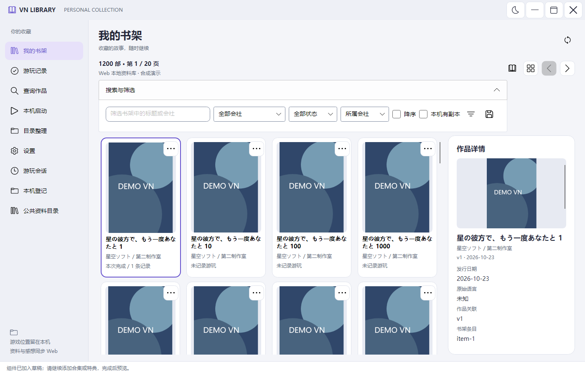
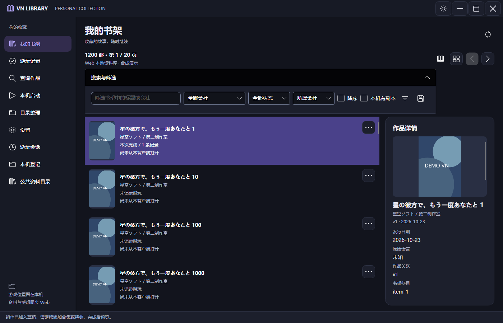

# VNDB Local

当前版本 **0.6.2**（SemVer `0.6.2`），采用 [Apache-2.0](LICENSE)。

基于 .NET 10 的个人视觉小说资料库与启动器。Docker Web 保存完整数据库，桌面端提供书架、游戏启动及本机目录管理，CLI 提供命令行查询和整理入口。

- 管理作品、会社、封面、发行版本与语言，以及个人游玩状态、时间、评分和感想。
- 优先查询 Web 本库；Web 不可达时，客户端可读取本机 JSON 或直连 VNDB，联网后同步。
- 支持导入 VNDB 官方公共资料包，在局域网内检索资料。
- 本机安装目录、安装包位置、启动参数和 Locale Emulator 配置只保存在客户端；Web 只记录“本地已有”标记。

## 开始使用

| 入口 | 说明 |
| --- | --- |
| [Docker／NAS 部署](docs/DOCKER.md) | 安装、配置、备份、恢复与升级 |
| [桌面端](docs/DESKTOP.md) | 书架、启动、安装包登记、游玩编辑与目录整理 |
| [CLI](docs/CLI.md) | 查询、JSON 导出、同步、整理与复原命令 |
| [Web API](docs/WEB-API.md) | 接口、鉴权、请求格式、错误与重试 |
| [公共资料目录](docs/CATALOG.md) | 发行语言筛选、官方资料导入和任务管理 |
| [离线部署包](docs/OFFLINE-DISTRIBUTION.md) | 在其他机器上建立独立资料库 |
| [数据与隐私](docs/DATA-AND-PRIVACY.md) | 数据位置、客户端／Web 边界和备份注意事项 |

保留桌面发布包的完整目录，运行 `Vndb.Desktop.exe`，在设置中填写 Web 根地址。CLI 示例：

```powershell
vndb vn get v17 --server http://nas.local:5187/ --json
vndb vn releases v17 --server http://nas.local:5187/ --json
vndb vn search "Example" --server http://nas.local:5187/ --json
```

已有本库资料可只读访问；首次联网补全、个人修改和同步需要应用管理密钥。桌面与 CLI 使用系统“文档”目录下的 `VndbLocal` 保存 JSON，升级程序不覆盖这份数据。

目录整理先预览、确认，再同卷移动完整游戏目录，保留复原记录；不删除游戏、不复制、不建链接或合并冲突。目录名称规则见[兼容命名](docs/FILESYSTEM-NAMING.md)。数据来源为 [VNDB](https://vndb.org/)，许可见[第三方说明](THIRD-PARTY-NOTICES.md)。

## 界面预览

历史合成演示截图，作品、游玩记录和占位封面均为演示数据。






