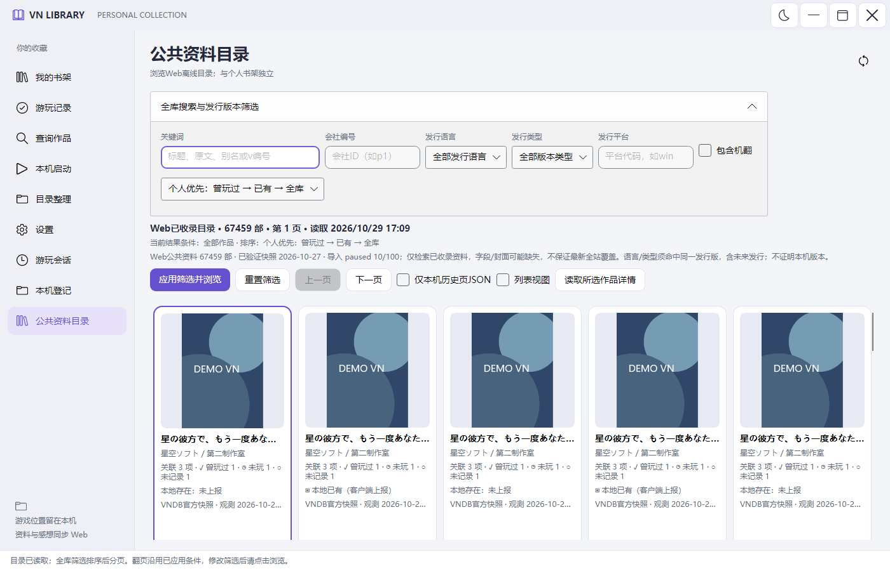

# VNDB Local

基于 .NET 10 的个人视觉小说资料库与启动器。当前版本 **0.7.0**，采用 [Apache-2.0](LICENSE)。

Docker Web 维护完整资料库；桌面端提供书架、启动及本机目录管理；CLI 提供脚本查询、JSON 交换和目录整理入口。

- 作品、会社、封面、发行版本与语言检索，支持导入 VNDB 官方公共资料包。
- 个人游玩状态、时间、评分、感想、收藏、虚拟集合与标签管理。
- Web 本库优先查询，缺失时联网收录；Web 不可达时，客户端可使用已有 JSON 或直接查询 VNDB。
- 本机安装、安装包、启动配置、转区工具及修复记录保存在客户端 JSON；Web 只接收“本地已有”布尔值。
- 目录整理采用预览、确认、同卷移动及可复原回执，保持游戏内部结构。

## 开始使用

**部署服务**：按 [Docker／NAS 部署指南](docs/DOCKER.md)准备数据卷和独立应用密钥，启动 `library` 服务，再打开配置的地址。默认仅监听 `127.0.0.1:5187`，局域网访问需明确设置绑定地址。

**桌面端**：保留发布包的整个目录，运行 `Vndb.Desktop.exe`，在设置中填写服务根地址。配置与本机登记默认保存在系统“文档”下的 `VndbLocal`，与程序位置无关。

**CLI**：使用对应平台的发布包，例如：

```powershell
vndb vn get v17 --server http://nas.local:5187/ --json
vndb vn releases v17 --server http://nas.local:5187/ --json
vndb vn search "Example" --server http://nas.local:5187/ --json
```

已有本库资料可只读访问；联网收录、个人修改与同步需要应用管理密钥。全部地址和目录示例均为通用示例。

## 架构与文档

| 文档 | 内容 |
| --- | --- |
| [架构](docs/ARCHITECTURE.md) | 模块职责、依赖方向、查询和同步流程 |
| [Docker／NAS](docs/DOCKER.md) | 构建、配置、升级、备份及离线恢复 |
| [数据与隐私](docs/DATA-AND-PRIVACY.md) | 数据位置、Web／客户端边界及备份范围 |
| [公共资料目录](docs/CATALOG.md) | 发行语言、官方导入、更新与容量管理 |
| [桌面端](docs/DESKTOP.md) | 书架、启动、修复、登记、整理与同步 |
| [CLI](docs/CLI.md) | 查询、JSON、脚本及整理命令参考 |
| [Web API](docs/WEB-API.md) | API v1、鉴权、数据交换与错误处理 |
| [目录命名](docs/FILESYSTEM-NAMING.md) | 兼容别名、冲突与复原规则 |

Web 和 Admin 通过 Library 管理 SQLite；客户端通过 API 使用 Web，通过 Local 管理本机 JSON。Core 提供共享规则和 VNDB 协议。系统使用单应用管理密钥，面向可信局域网中的个人使用，不提供多用户隔离。

从源码构建需要 `global.json` 兼容的 .NET 10 SDK、PowerShell 7、Python 3 和 Node.js。运行 `./scripts/Test.ps1` 验证，再按部署指南串行发布；构建、日志和发布产物默认位于仓库旁的 `VndbCli.private`。正式包的目标平台、版本和校验信息以 `release-manifest.json` 为准。

## 界面预览

以下为合成演示截图，内容均为演示数据。




数据来源为 [VNDB](https://vndb.org/)。官方公共资料包不包含整个网站或全部图片，导入范围见公共资料目录说明。第三方代码、字体、图标和数据许可见[第三方说明](THIRD-PARTY-NOTICES.md)。
