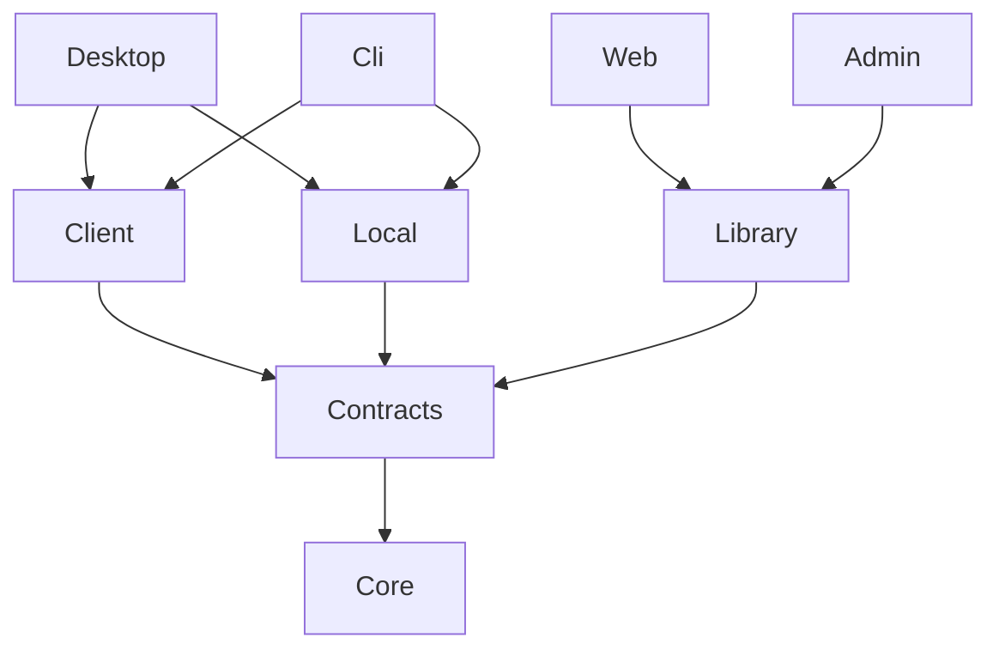

# 架构与职责

适用版本：0.7.0；客户端协议：API v1；服务端 SQLite：schema15。

项目由一个 Docker Web 服务、桌面客户端和 CLI 组成。完整数据库只部署在服务端，本机安装与启动能力可离线使用。共享规则按用途放入 Core、Local 和 Library，入口项目负责参数、界面与宿主组装。

## 模块划分

| 项目 | 职责 | 主要依赖 |
| --- | --- | --- |
| `Vndb.Core` | VNDB 协议、公共作品模型、规范化与查询规则 | 无项目依赖 |
| `Vndb.Contracts` | API v1、JSON 交换、操作身份与公共 DTO | Core |
| `Vndb.Client` | Web HTTP 客户端、查询来源协调、查询 JSON 与待导入数据 | Core、Contracts |
| `Vndb.Local` | 本机 JSON、安装与资源登记、目录观测、整理复原、启动及修复 | Core、Contracts |
| `Vndb.Library` | SQLite、公开及个人资料业务、官方资料任务、封面与完整快照 | Core、Contracts |
| `Vndb.Web` | ASP.NET Core API、静态前端、配置及既有后台任务宿主 | Core、Contracts、Library |
| `Vndb.Admin` | 受控数据库维护、官方包处理、完整快照与隔离恢复 | Core、Contracts、Library |
| `Vndb.Cli` | 命令行解析、脚本输入与输出、客户端流程组装 | Core、Contracts、Client、Local |
| `Vndb.Desktop` | Avalonia、CommunityToolkit.Mvvm、视图与交互协调 | Core、Contracts、Client、Local |

以下箭头表示主要项目引用，省略直接指向 Core 的重复边：

Core 和 Contracts 不依赖 UI、宿主或数据库。本机客户端不引用 Library、Web、Admin 或 SQLite；Web 和 Admin 不引用本机执行模块。Admin 不通过 CLI 间接访问数据库。依赖约束由 `scripts/check_architecture.py` 检查。

## 数据归属

**Web 权威数据**包括作品、会社、发行目录、封面缓存、个人条目、游玩经历、时间、评价、收藏、分类和按设备上报的存在布尔值。SQLite 位于部署数据卷，客户端通过 HTTP API 访问。

**本机数据**包括安装目录、组件结构、包和资源位置、EXE、参数、工作目录、转区工具、注册表及配置修复备份、整理回执。它们保存为 JSON，不上传 Web。客户端另有按服务隔离的资料缓存、离线个人编辑和待同步回执；缓存不替代服务端数据库。

公共作品使用 VNDB ID；个人条目、具体游玩经历、设备、安装和操作各有独立身份。同一作品的不同个人版本或重玩经历不能仅按 VNDB ID 合并。“已玩”“明确未玩”“未记录”和“本地已有”是不同维度；已有安装包也不证明能直接启动。

## 查询流程

1. 客户端默认访问已配置的 Web。Web 本库命中直接返回；缺失时通过 Core 查询 VNDB，再由 Library 持久化。
2. Web 的本库读取不等待其他联网查询。联网段保留节流、重复请求核对及有界重试；显式刷新不修改个人评价和时间。
3. Web 不可达时，客户端可读取当前服务作用域的 JSON，或通过 Core 直连 VNDB，生成可导入 Web 的资料。鉴权、协议、冲突和限流错误不作为断线绕过。
4. 公共目录浏览只检索 Web 已收录数据，先筛选和排序再分页，不因零命中自动联网。客户端离线仅能回显已缓存的同条件历史页。

## 同步与后台任务

个人编辑、分类、会话和存在标记沿用各自稳定操作 ID、修订与回执。回复丢失时重试原操作，明确冲突时保留原稿并重新读取；不能用一次相同内容的 GET 代替写入确认。数据按 Web 地址和服务实例校验，不能把另一服务的待同步文件直接搬来使用。

资料补全、官方导入和可选定时同步复用 Web 内现有后台任务。关闭页面不会取消已接收任务。定时同步默认关闭；检查官方日期与下载、导入是不同操作。项目不要求外置数据库、消息队列或额外自动化服务。

本机变化观测仅在桌面运行且显式启用时工作。浅层文件事件触发实际核对，并有周期复查；不会因事件直接安装、卸载、重命名或重新信任启动程序。CLI 提供一次性检查，不提供常驻监听服务。

## 部署与兼容

Docker 运行单个 `library` 服务，持久数据与镜像分离。桌面和 CLI 可独立更新；启动前通过 `/api/v1/info` 发现协议、能力、服务身份及导入限额。产品版本、API 版本、数据库 schema 和发布代际分别记录，不能互相替代。

当前 Web 会增量升级至 schema15。完整快照保留实例、已登记封面、数据库版本和镜像信息；恢复只写全新目录，升级后回退旧镜像需配套旧库快照。源码、发布包、公共资料包和私人灾备各自保管，禁止将运行配置、密钥或个人数据库放入源码／分发包。

部署步骤见 [Docker／NAS](DOCKER.md)，文件位置见[数据与隐私](DATA-AND-PRIVACY.md)，接口契约见 [Web API](WEB-API.md)。
